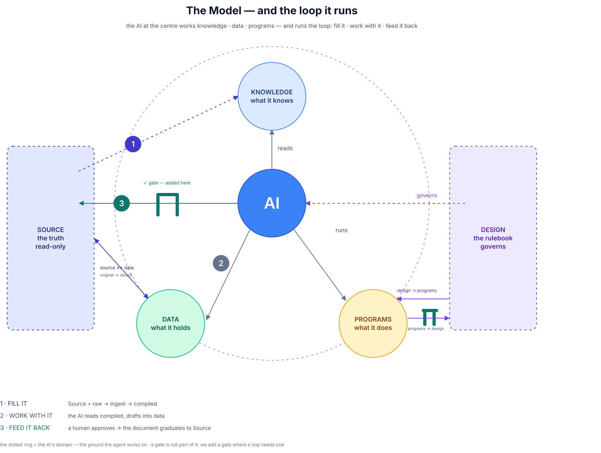

<!-- Public edition of the blueprint, maintained by hand. Do not regenerate with export.py: see .agents/skills/github/SKILL.md § Exporting a page. -->

# Thermalwind Information Management System Blueprint

> **Status**: Proposed — the theoretical design. **Version 1.1.**
> **Two jobs**: (1) the basis for the public reference repo; (2) the target a running instance converges toward.
> **Declared gap**: this document states the *ideal*. Where a running instance differs — and where it runs ahead — that difference is kept separately; this blueprint is the target, the running system is today's truth.

---

## 0. The idea in one line

**A company's knowledge, data and programs live local-first, in files the company owns; an agent reads the knowledge, works the data and runs the programs; what it produces is a draft, which a person works over and feeds back in as knowledge or data.**

A company holds three things: **knowledge** (what it knows), **data** (what it holds) and **programs** (what it does). The system is the **Thermalwind Information Management System (TIMS)**: it keeps all three local-first — on the company's own machines, in open files it controls — with any server in a supporting role, never the source of truth. **The agent** — the AI at work — is the worker on top: it reads the knowledge, works the data and runs the programs. What it produces is a **draft, never the truth**. A person works it over: a finished document graduates to **Source**, everything else goes back in as knowledge or data, where the next round builds on it. Two things no tool may touch: the **originals** the company received or wrote itself, and the **design** the system runs by.

---

## 1. The problems observed

- A company's knowledge, data and routines sit in many apps. None can be read as one, and none is owned outright.
- The everyday tools are old and closed to an agent: Word, Excel, MS Project. The modern ones can be driven, but they are scattered, expensive, and not the company's.
- An AI pointed at loose files produces generic, unverifiable answers. It **hallucinates** — inventing facts, figures and citations — and states them with the same confidence as the truth.
- It also **lies**: it quietly drops or changes what it was given, and gives no signal that it did. Nothing it produces can be used unchecked, so the speed it promised is lost to re-checking.
- Answers are re-derived on every question instead of being written down once and kept current.
- Records and numbers live in tools the company does not control, on servers it does not own.
- There is no line between the solid originals and the derived summaries, so nothing can be traced back.
- Work is locked into formats and services that may not exist in ten years. Nothing outlives the tool.
- An automated system can change things with no human gate.

None of this is about the model. It is about the missing layer between the company's material and the AI.

---

## 2. The principles (the durable core)

1. **Source is authoritative.** The originals — received or human-authored — are never modified by a tool. The agent reads them.
2. **Compile, don't retrieve.** Knowledge is distilled once into stable pages, then kept current, rather than searched fresh on every question.
3. **The agent's output is a disposable cache.** The *generated* text is regeneratable: delete it, rebuild it. The asset is the originals, the human's own edits, and the design — never the generated text.
4. **Design precedes tools.** The system runs on a written design, not on an app. Agents read the design as binding rules; changing it needs human approval.
5. **Data, in open formats, in files you own.** Markdown files, owned outright; a database you own.
6. **Model and host are a commodity.** Any LLM, any runtime. Choose the model by your data rules, not by a vendor's roadmap.
7. **Make the system transferable.** The goal is that the owner no longer needs the builder — a hand-over, not a lock-in.
8. **Humans can write at every layer.** The agent's layers are not agent-only. A person can correct a compiled paragraph, add a table in the database, or state a change in the chat — it is all input the system takes, and every layer has a direct way in. The agent clarifies what it implies and executes it after approval; it never silently overwrites the human's edit.
9. **The irreplaceable is backed up and versioned.** Originals, structured data and the design are the only things that cannot be regenerated — they are what gets a backup and a history.

---

## 3. The layers

Two authorities stand **outside the loop** — **Design**, the rulebook, and **Source**, the truth — reachable by a tool only through an approval **gate**. Inside the loop sit the three things the agent works with: **compiled knowledge** (it reads), **structured data** (it works) and **programs** (it runs). The **agent** is not one of these layers; it is the worker that moves between them.

| Layer                  | What it holds                                                                                                                  | Who writes                                 | Regeneratable?                                       |
| ---------------------- | ------------------------------------------------------------------------------------------------------------------------------ | ------------------------------------------ | ---------------------------------------------------- |
| **Design**             | the rulebook: architecture, principles, conventions, the skill registry                                                        | human, by approval                         | no — it is the design                                |
| **Source**             | originals — received documents, exports, contracts, e-mails; human-authored originals                                          | human (write-seldom)                       | no                                                   |
| **Compiled knowledge** | the unstructured half: distilled prose pages and audience-scoped compiled knowledge                                            | agent **and human**                        | **yes — the generated text** (human edits preserved) |
| **Structured data**    | data stored in a container that enforces it: flat records (contacts, tasks), databases (records that link to records), ledgers | agent, within workflows **and human**      | no                                                   |
| **Programs**           | the capability the agent runs: scripts, skills, the bootstrap chain                                                            | human; agent-authored **through the gate** | no — programs are authored                           |

**One-way wall.** Two things no tool touches on its own: **Source** and **Design** — a tool reaches them only through an approval **gate** (the ⛩ on the drawing). The **agent** writes the compiled layer and, within workflows, structured data; the **human** writes wherever it chooses, and the agent absorbs that edit rather than undoing it.

**The dotted ring is the agent's domain** — the ground it works on, and the loop it runs. Knowledge sits fully inside it; data and programs straddle it, because a person writes there too. A gate is not part of that domain: a gate is something we **add** where a hop needs one. §6 shows the same picture running.

**Each authority backs two things.** **Source** backs **both natures** — the *what*; **Design** backs **the capability** — the *how*. Where an authority backs a thing, that thing **cites** it and never copies it: a compiled paragraph cites its original, a record keeps its provenance, a program registers back into the registry — the last one **through a gate**.

| Authority  | Backs                  | The interface                                                                                                                                                       |
| ---------- | ---------------------- | ------------------------------------------------------------------------------------------------------------------------------------------------------------------- |
| **Source** | **compiled knowledge** | **ingest** — distilled from the original, regeneratable                                                                                                             |
| **Source** | **structured data**    | **transcription + provenance** — a record is entered from an original and keeps the pointer back, so the record and the document can always be reconciled           |
| **Design** | **programs**           | **the registry and the skill** — Design says what a capability is for (outward, no gate); the program registers back into the registry (inward, **through a gate**) |
| **Design** | the whole loop         | **governs** — the rules bind whatever the loop does                                                                                                                 |

---

## 4. Two natures, and they are opposites

The originals are the truth (§3). Everything else is **data**, in one of two natures — and the two are opposites:

| Nature                 | Shape                                                               | Home                                 | Read as          |
| ---------------------- | ------------------------------------------------------------------- | ------------------------------------ | ---------------- |
| **Structured data**    | a record with a defined shape — a flat record, a database, a ledger | a container that enforces that shape | a card / a table |
| **Compiled knowledge** | a prose page — unstructured by nature                               | the compiled layer                   | narrative        |

A **record** is the unit of the structured half: one entry, in a shape that is written down, held by a container that enforces it. A paragraph is not a record. A table inside a document is not a record either — records live in a store that keeps them, not in a page that shows them.

**Compiled knowledge is unstructured; structured data is not.** Prose is free-form, distilled from sources and regeneratable; records are shape-bound, irreplaceable and queried. Some systems handle prose well and records badly — a sheet per process, a total typed by hand. The database is where a business's *numbers and structured records* live (inventory, projects, licences, control frameworks, cost models), with joins, roll-ups and a reconciliation check. That is what makes this a **business operating layer**, not a note-taking app. And every record keeps its **pointer back to the original** it was entered from, so the number and the document can always be reconciled (§3).

---

## 5. The routing rule — what goes where

Given a thing, ask **in order**; the first *yes* decides.

| # | The question                                                                                                                                             | →                   |
| - | -------------------------------------------------------------------------------------------------------------------------------------------------------- | ------------------- |
| 1 | **Is it an original?** A received document, drawing, export or contract — or a human-authored original.                                                  | **Source**          |
| 2 | **Is a structured place designed for it?** A schema and a home, where it is queried, filtered, joined, totalled, or kept secure and auditable long term. | **Structured data** |
| 3 | **If neither: it stays knowledge.** Narrative, analysis, decision, design, draft — read by a human and an agent.                                         | **Compiled**        |

- **Compiled is the default.** Source can be **compiled automatically** into compiled knowledge, so it is the home for everything with no designed structure. But the compiled layer **drifts, expands and grows**.
- **Structured is a decision.** When a piece must survive that drift — kept **long term**, **secure**, **auditable**, or linked to other records — we **design a structured home** for it. Structuring brings machinery with it: a **workflow, a program, a module**.

Then, inside **Structured data**: *records that link to other records → a **database** or a **ledger**; a flat list of a few fields → a flat record.* Inside **Compiled**: *distilled from sources → regeneratable; original analysis/decision → preserved.*

The **writer decides the tier, not the file type**: a received `.xlsx` is Source; the same `.xlsx` we edit in a tool is structured data.

---

## 6. The lifecycle — fill it, work with it, feed it back

§3 is the still picture. This is the same model running: the agent at the centre, the loop passing through the three things it works with, and one gate on the hop that writes back.

- **1 · Fill it.** New material arrives — a one-off snippet goes to a staging area, a permanent file stays in **Source**, and it is **registered**, so it is compiled once and not on every question. **Ingest** then distils it into **compiled knowledge**.
- **2 · Work with it.** The agent reads the compiled layer and drafts new work — a page, a document, a record — into the layer that fits it (§5). The **programs** it runs are how it does that.
- **3 · Feed it back.** A human approves; a finished document **graduates to Source**, and the next ingest folds it back in. The loop closes.

The gate is the point of the whole loop: nothing irreversible happens without a human at the boundary.

---

## 7. The agent model

**What an agent is.** One session: the model, the tools it can call, the bootstrap chain it reads before it acts, and the skills it may run. Nothing else. It holds no memory of its own — what it knows between sessions, it reads from the layers (§3).

- **Skills are the unit of capability** — one reusable workflow each (ingest, query, lint, write, research, export…). If a skill exists, never do its job by hand. A skill the agent writes is a design act: it registers back **through the gate** (§3).
- **A script is not a skill** — a script does one deterministic job and judges nothing; a skill is a declared workflow the agent follows and can adapt. Both are Programs (§3).
- **Tools are how it acts** — one tool is one capability the runtime exposes (read a file, query the register, send a mail).
- **The bootstrap chain** — every session begins by reading a chain: the entry file → the map → the schema → the design. A **preflight** check detects drift between design and reality before acting.
- **Open standards** — `AGENTS.md` for the instructions, `SKILL.md` for a capability, `MCP` for the tools. That is what makes the agent (somewhat) agnostic: the same system runs on opencode, Claude or Kilo, because the canonical content lives in the standard files and only thin per-tool adapters differ.

---

## 8. Structured data

A dataset has outgrown a note when it must **last, stay secure, be auditable or link to other records** (§5) — then we give it the structured form. The shape is the same every time:

- **The right container for the data** — a database, bookkeeping software or what suits it best; ideally open source, and always one whose data you own and can export.
- **Linked tables, not widened sheets** — an item points at a code; nothing is typed twice.
- **One formula layer**, versioned — the calculation lives in the schema, not in forty sheets.
- **Reconciliation is a column** — the headline number must agree (`check = 0`).
- **Views are queries** — entry, summary and report are three views over one table, zero duplicated data.
- **The human edits the live store too** — adding or removing a table by hand is normal. The agent then **diffs the live store against the design** and reconciles the two, rather than assuming the design is truth or reverting the change.

---

## 9. Trust & governance

- **Approval gates are explicit and recorded** — Design and Source change only when a *named* human approves.
- **A human edit ends the agent's ownership** — once a person has edited a page, the agent stops rewriting it. It takes the edit as an instruction, like one given in the chat, and holds the version from before the change until the edit is approved.
- **Every page is either draft or approved** — and whatever the model generates is marked **generated**. *Draft*: still moving; the agent may rebuild it. *Approved*: the human is happy; it is frozen, and rebuilds work around it.
- **Provenance is carried, not remembered** — every claim travels with its pointer and its mark (*extracted* / *inferred* / *ambiguous*). A claim without them is not usable.
- **Visibility labels gate a hand-over** — a graded label per page (`client` · `client-restricted` · `internal`). A hand-over is a **label-filtered export**, never a blind folder copy.
- **Redaction survives regeneration** — a page rebuilt from Source would return un-redacted, so a redaction is recorded in the ingest rules, not only on the page.

---

## 10. What implements this today

This blueprint is the *ideal*. The concrete instance is a running vault, with its own tools (Obsidian, a model API, a database app, a mail/calendar stack) and its own paths. **Where the implementation diverges from this blueprint — and where it runs ahead of it — is recorded as the gap between the two.**

Nothing in this design requires a particular application. The compiled layer is generated by an **agent following skills** — one to distil a source, one to query it, one to audit the result, one to connect it — and a running instance can take that skill set from an existing packaged framework instead of writing every skill from scratch (one is credited in §11). Which skills exist, and how far each was edited, belongs to the instance, not here.

---

## 11. Inspiration

Where the ideas come from.

| Influence                                                                                                                                                                                                       | What we take from it                                                                    | Where it lives here   |
| --------------------------------------------------------------------------------------------------------------------------------------------------------------------------------------------------------------- | --------------------------------------------------------------------------------------- | --------------------- |
| **Andrej Karpathy — the LLM Wiki pattern** ([gist](https://gist.github.com/karpathy/442a6bf555914893e9891c11519de94f))                                                                                          | Compile, don't retrieve: raw → wiki → schema                                            | the foundation (§2.2) |
| **Ar9av — obsidian-wiki** ([repo](https://github.com/Ar9av/obsidian-wiki))                                                                                                                                     | A ready-made skill set for the pattern — ingest, query, lint, cross-link, dashboards — taken as the starting point and then edited                | the compiled layer's tooling (§3, §10) |
| **Ink & Switch / Martin Kleppmann — local-first software** ([essay](https://www.inkandswitch.com/essay/local-first/))                                                                                           | You own your data; a server is a supporting peer, never the source of truth             | §0, §2.5              |
| **Steph Ango — file over app** ([essay](https://stephango.com/file-over-app))                                                                                                                                   | Files you control, in formats that outlive the tool                                     | §2.5                  |
| **Anthropic — the Model Context Protocol** ([standard](https://modelcontextprotocol.io/)) · **context engineering** ([post](https://www.anthropic.com/engineering/effective-context-engineering-for-ai-agents)) | The open standard that connects an agent to tools and data; shaping what the model sees | §7                    |

---

## 12. Terms

The vocabulary this document leans on, so no reader has to infer it.

| Term                 | Meaning                                                                                                                                                                                                                                         |
| -------------------- | ----------------------------------------------------------------------------------------------------------------------------------------------------------------------------------------------------------------------------------------------- |
| **agent**            | the worker: one session with a model, tools, the bootstrap chain and the skills it may run (§7). "The AI", "the model" and "the agent" all appear in this document; the *whole thing* is the agent, the *language model* inside it is the model |
| **model**            | the language model the agent runs on — a commodity, chosen by the data rules, not the vendor (§2.6)                                                                                                                                             |
| **tool**             | one capability the runtime exposes to the agent (read a file, query the register, send a mail); described by the open standard **MCP**                                                                                                          |
| **skill**            | a declared, reusable workflow the agent follows and can adapt — one `SKILL.md` per skill (§7)                                                                                                                                                   |
| **program**          | scripts and skills together, plus the bootstrap chain: the capability the agent runs (§3)                                                                                                                                                       |
| **registry**         | the index of the skills and programs that exist — the design's inventory of its own capability (§3)                                                                                                                                             |
| **record**           | the unit of structured data: one entry, in a shape that is written down, held by a container that enforces it (§4)                                                                                                                              |
| **ingest**           | distilling a source into a compiled page — once, with a pointer back (§6)                                                                                                                                                                       |
| **provenance**       | the pointer from a claim back to its original, plus its mark — *extracted* (stated in the source), *inferred* (concluded from it), *ambiguous* (the source can be read more than one way) (§9)                                                  |
| **gate**             | an approval point on a hop that needs one — the ⛩ on the drawing (§3)                                                                                                                                                                           |
| **draft / approved** | the state of a page: *draft* may be rebuilt, *approved* is frozen and rebuilt around (§9)                                                                                                                                                       |
| **hand-over**        | handing the running system to its owner: a label-filtered bundle of the compiled layer, the design and the skills (§2.7, §9)                                                                                                                    |
| **builder / owner**  | the builder designs the system and hands it over; the owner runs it, and does not need the builder (§2.7)                                                                                                                                       |

---

## The figures

Every figure in this document is a **print** cut from one master drawing, so two sections can never show two different pictures.
