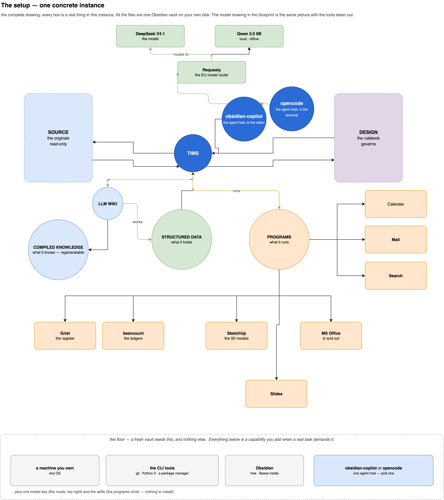

# Implement it

> **Status: in progress.** The drawing and the dependency list below are done. The walk-through
> is still the plan, and gets written as it is walked — a start guide nobody has followed is
> fiction. The first pass is done on a fresh, empty vault, and every step picks up its numbers
> as it happens: what broke, what it cost, what had to be explained.

## The setup, one concrete instance

## What you need to start

See below the dependencies you need to install first. They lead to a **minimal system** — nothing
more is required to begin.  The detail for each one — what it is, why it is here, where it comes
from — lives in [Dependencies](#dependencies) below.

The method itself is row 8, and it is not software. It is three things: **the pattern** that turns
raw sources into compiled pages, **the skills** that run it, and **the design** that acts as its
schema. You write the first in the chat; [`template/`](template/) gives you the shape of the other
two.

| #   | Install first                                                                         | Why it comes first                                                                                                                                                                                                                                                                                                                                                          |
| --- | ------------------------------------------------------------------------------------- | --------------------------------------------------------------------------------------------------------------------------------------------------------------------------------------------------------------------------------------------------------------------------------------------------------------------------------------------------------------------------- |
| 1   | **A machine you own**                                                                 | Any OS. Nothing hosted, nothing signed up for — the whole system runs on it.                                                                                                                                                                                                                                                                                                |
| 2   | **A package manager** — ours: Homebrew                                                | Installs everything below. Homebrew is macOS only — **winget** ships with Windows, and Linux has its own.                                                                                                                                                                                                                                                                   |
| 3   | **git**                                                                               | Version control: history, and the rollback when the agent gets something wrong.                                                                                                                                                                                                                                                                                             |
| 4   | **Python 3**                                                                          | The scripting runtime — the scripts the skills call are Python.                                                                                                                                                                                                                                                                                                             |
| 5   | **Obsidian**                                                                          | Holds the vault and hosts the agent. Bases ships with it, so no plugins are needed to start.                                                                                                                                                                                                                                                                                |
| 6   | **One agent host** — `obsidian-copilot` (in Obsidian) or `opencode` (in the terminal) | Reads the vault and runs the skills. One is enough.                                                                                                                                                                                                                                                                                                                         |
| 7   | **Access to a model** — ours: DeepSeek via Requesty                                   | The thinking. Any OpenAI-compatible key works; swapping it is a line of config.                                                                                                                                                                                                                                                                                             |
| 8   | **The LLM wiki** — the method                                                         | **How you install it:** `pip install obsidian-wiki`, then `obsidian-wiki setup --vault ~/your-vault --project . --copy` — 35 skills land in `.agents/skills/`, yours to edit. Two warnings: run it in a **fresh** vault, because it writes an `AGENTS.md` of its own and that overwrites yours; and never re-run it blindly, because it replaces the skills you have edited. |
| 9   | **One store** — ours: Grist                                                           | Records that must link to records. A database, not more notes.                                                                                                                                                                                                                                                                                                              |
| 10  | **Web search** — ours: SearXNG                                                        | Grounding beyond the vault. Add it the day you first need the net.                                                                                                                                                                                                                                                                                                          |
Everything else you can see in the drawing above is a capability we added, not a part of the
system: the mail, calendar and contacts stacks, the ledgers, the media and OCR tools, the home
network, the local-model UIs, the desktop apps. They have boxes because they are real in our
instance, not because you need them.

## 1 · Start up

- [ ] Copy [`template/`](template/) to the root of your own vault.
- [ ] Open it. Replace the `[placeholders]` in `_design/CHARTER.md` with your own words.
- [ ] Point an agent at `AGENTS.md` and ask it what it sees.

## 2 · The first grounded task

- [ ] Put one real document in `Source/`.
- [ ] Ask one real question about it.
- The moment it either answers from the document or admits it cannot is the moment the
  system is real. Everything before that is setup.

## 3 · Make it yours

- [ ] Which domains do you have? Write them into `MAP.md`.
- [ ] Get your git backup running — if it breaks, you can roll back.
- [ ] Write the second skill. The first one is an example; the second one is yours.

## 4 · What breaks

It will break, especially at the beginning. Ask the agent, and ask it for fixes — but be
careful: what you approve is what you get.

## 5 · Discipline

This is my system; you need to build yours. Make sure your ideas land in the design, that you
feed your results back into Source, and that when something unexpected happens you ask and stay
curious: *this is an interesting result — why?*

## Dependencies

See below the programs I used. **You don't need them all** — this is a jumpstart, not a shopping
list. The **Need** column holds the number of the row in [What you need to start](#what-you-need-to-start)
that the program satisfies: **1–10** is the minimum, **—** arrived later,
when a real task asked for it, and the design survives without it.

| Thing            | What it is                                                                                                        | Why it is here                                                              | Need |
| ---------------- | ----------------------------------------------------------------------------------------------------------------- | --------------------------------------------------------------------------- | ---- |
| **the LLM wiki** | the distillation pattern *and* the skill set that runs it — raw sources in, a compiled wiki the agent maintains (Karpathy's idea file, April 2026; the skills come from the packaged framework in route 2) | it is the thing that grows in value; every program below exists to serve it | 8    |

**Getting it — simplest route first.**

| Route | What you do | Where |
| --- | --- | --- |
| **1 · the pattern, written in the chat**  | Paste the idea file into your agent and tell it to set the wiki up in your vault. No installer, no dependency. | [Karpathy's idea file](https://gist.github.com/karpathy/442a6bf555914893e9891c11519de94f) |
| **2 · the packaged framework** — *the one used here* | `pip install obsidian-wiki`, then `obsidian-wiki setup --vault ~/your-vault --project . --copy` to keep the skills inside the vault (plain `obsidian-wiki setup` puts them in every agent it finds, outside any one vault). It brings the whole set — ingest, query, lint, cross-link, dashboards — plus an `AGENTS.md` of its own. Two things to know before you run it: use a **fresh** vault, and re-run it only after diffing, because it replaces skills you have edited. Prefer a single skill? `npx add-skill Astro-Han/karpathy-llm-wiki`. | [Ar9av/obsidian-wiki](https://github.com/Ar9av/obsidian-wiki) · [Astro-Han/karpathy-llm-wiki](https://github.com/Astro-Han/karpathy-llm-wiki) |
| **3 · the self-hosted application** | `git clone` and run it with Python 3.11+ and Node.js 20+ (`./llmwiki open ~/your-folder`) — a web UI, a local index, and an MCP server for the agent. | [lucasastorian/llmwiki](https://github.com/lucasastorian/llmwiki) |

### Platform & runtime

| Tool | What it is | Why it is here | Need |
| --- | --- | --- | --- |
| a host OS — ours: macOS | the OS the vault and every local tool run on | any OS works; macOS only because of on-device OCR, timers and the compiler the OCR helper is built with | 1 |
| a package manager — ours: [Homebrew](https://github.com/Homebrew/brew) | the CLI installer | Homebrew is **macOS only**; Windows ships with **winget**, Linux has its own — nothing below cares which you use | 2 |
| [git](https://git-scm.com/) | version control | history, and the rollback when something goes wrong | 3 |
| [gh](https://cli.github.com/) — the GitHub CLI | git hosting from the terminal | pull requests, issues and releases, so an agent can open a PR instead of describing one | — |
| [Python 3](https://www.python.org/) | the scripting runtime | the export, report and convert scripts are Python | 4 |
| [Node.js](https://github.com/nodejs/node) | the JavaScript runtime | the JavaScript scripts and widget development | — |
| [colima](https://github.com/abiosoft/colima) + [Docker](https://github.com/moby/moby) | container runtime | runs the self-hosted services without a cloud | — |
| [Obsidian](https://obsidian.md) | the editor and host — the front end of the whole system | files, links, Bases, plugins, the agent | 5 |

### Registers & project data

| Tool | What it is | Why it is here | Need |
| --- | --- | --- | --- |
| [Grist](https://github.com/gristlabs/grist-core) | self-hosted relational spreadsheet — the register store | project data as **linked tables** instead of one note per row | 9 |
| [Grist MCP server](https://github.com/modelcontextprotocol/python-sdk) | exposes a Grist document's reads, records and schema as tools | the agent's path to the whole document | 9 |
| [TaskFlow widget](https://github.com/nic01asFr/Widgets-Grist) | a Grist custom widget | shows register rows as a board inside a document | — |
| [TaskJuggler](https://github.com/taskjuggler/TaskJuggler) | project-planning engine from a plain-text plan | dates, dependencies, resources, the critical path | — |

### Documents

| Tool | What it is | Why it is here | Need |
| --- | --- | --- | --- |
| [Miyo](https://www.miyo.md/) | local, on-device document processor | PDF and EPUB in, text out — the document never leaves the machine | — |
| [MuPDF](https://github.com/ArtifexSoftware/mupdf) (`mutool`) | PDF toolkit | renders pages to images as the first step of OCR | — |
| Apple Vision (`swiftc`) | macOS on-device OCR | the default local OCR engine — multilingual, offline | — |
| [Tesseract](https://github.com/tesseract-ocr/tesseract) | open-source OCR engine | the fallback when Apple Vision is unavailable | — |

### Web search

| Tool | What it is | Why it is here | Need |
| --- | --- | --- | --- |
| [SearXNG](https://github.com/searxng/searxng) | privacy-respecting meta-search engine | the search backend for agents — local, keyless, no cloud | 10 |

### Mail

| Tool | What it is | Why it is here | Need |
| --- | --- | --- | --- |
| [himalaya](https://github.com/pimalaya/himalaya) | CLI email client over IMAP/SMTP | read, search, reply, compose and send from the terminal | — |
| [isync](https://isync.sourceforge.io/) (`mbsync`) | IMAP → Maildir sync | one-way pull of a mailbox to a local folder | — |
| [notmuch](https://notmuchmail.org/) | mail indexer and search engine | fast full-text search of the local mirror | — |
| [age](https://github.com/FiloSottile/age) | file encryption tool | seals the credentials at rest | — |

### Calendar & contacts

| Tool | What it is | Why it is here | Need |
| --- | --- | --- | --- |
| [vdirsyncer](https://github.com/pimutils/vdirsyncer) | CalDAV/CardDAV sync engine | syncs calendars and contact cards to a local store outside the vault | — |
| [khal](https://github.com/pimutils/khal) | CLI calendar client | list, create, edit and search events | — |
| [khard](https://github.com/lucc/khard) | CLI address book client | list, show and email contacts | — |

### Bookkeeping

| Tool | What it is | Why it is here | Need |
| --- | --- | --- | --- |
| [beancount](https://github.com/beancount/beancount) | plain-text double-entry accounting engine | the primary ledger | — |
| [Fava](https://github.com/beancount/fava) | web UI for beancount | balance and P&L reports per book | — |
| [hledger](https://github.com/simonmichael/hledger) | alternate plain-text accounting tool | the second pair of eyes on a ledger | — |

### Content & slides

| Tool | What it is | Why it is here | Need |
| --- | --- | --- | --- |
| [reveal.js](https://github.com/hakimel/reveal.js) | the HTML presentation framework | renders and exports slide decks | — |
| [Slides Extended](https://github.com/ebullient/obsidian-slides-extended) | Obsidian plugin wrapping reveal.js | the slide engine, with a preview server | — |
| [Excalidraw](https://github.com/excalidraw/excalidraw) | diagramming tool, plus its Obsidian plugin | slide diagrams | — |
| [draw.io](https://www.drawio.com/) | diagram editor | this page's own drawing — and the edits you make to it | — |

### Media

| Tool | What it is | Why it is here | Need |
| --- | --- | --- | --- |
| [yt-dlp](https://github.com/yt-dlp/yt-dlp) | maintained media downloader | an offline copy of a pick, when you want one | — |
| [FFmpeg](https://github.com/FFmpeg/FFmpeg) | audio/video toolkit | yt-dlp needs it to merge video and audio | — |

### Agent runtime

| Tool | What it is | Why it is here | Need |
| --- | --- | --- | --- |
| [opencode](https://github.com/sst/opencode) | the managed agent binary | runs agent sessions through the configured provider | 6 |
| [Obsidian Copilot](https://github.com/logancyang/obsidian-copilot) | the plugin that hosts the agent inside Obsidian | the chat surface, the skill loader, the document-processor hook | 6 |
| [Requesty](https://requesty.ai) | the model router | one place to hold the key and change who does the thinking | 7 |
| a model — ours: DeepSeek | any OpenAI-compatible model | the thinking; swapping it is a line of config | 7 |

### Desktop apps

| Tool | What it is | Why it is here | Need |
| --- | --- | --- | --- |
| SketchUp | 3D modelling | a working model a tool both reads and writes | — |
| MS Office | spreadsheets and documents | the formats the world still sends you | — |

### Libraries

| Tool | What it is | Why it is here | Need |
| --- | --- | --- | --- |
| [MCP Python SDK](https://github.com/modelcontextprotocol/python-sdk) | Model Context Protocol client and server | how the scripts speak to a database endpoint | — |
| [PyYAML](https://github.com/yaml/pyyaml) | YAML parser for Python | reads the config and mapping files | — |

### Obsidian plugins

Community plugins; **Bases** is core and ships with Obsidian, so a vault with no plugins still
shows tables.

| Plugin | What it does |
| --- | --- |
| `copilot` | agent and document processor |
| `tasknotes` | the task system, as frontmatter tasks |
| `slides-extended` | the slide engine (reveal.js) |
| `obsidian-excalidraw-plugin` | diagrams |
| `obsidian-kanban` | kanban boards in markdown |
| `calendar`, `full-calendar-remastered` | calendar views |
| `sqlseal`, `sqlseal-charts` | SQL queries and charts over notes |
| `bases-new-with-template`, `kanban-bases-view` | Bases helpers |
| `better-export-pdf` | print/PDF export with a template |
| `drawio-editor` | draw.io diagrams in the vault |
| `word-reader` | read `.docx` in Obsidian |
| `hledger-dashboard` | hledger views |
| `code-view`, `contact-note`, `hide-sidebars`, `kilocode`, `obsidian-shellcommands` | utilities |

### Services we run ourselves

Ours, not the design's — listed without addresses, because the addresses are ours too. A single
machine needs none of this.

| Service | What it does |
| --- | --- |
| SearXNG | fallback search |
| Ollama | local LLM runtime |
| Open WebUI · AnythingLLM · Vane | local AI chat and document UIs |
| Home Assistant · ESPHome · Mosquitto | home automation and MQTT |
| Nginx Proxy Manager · Portainer | reverse proxy and container management |
| Syncthing · Nextcloud | file sync and sharing |

**One home, one list.** The design keeps exactly one page like this; every other document links
to it. Adding a tool means editing one file, dropping one means one search finds every use. Yours
can be longer — but it should still be one list.
