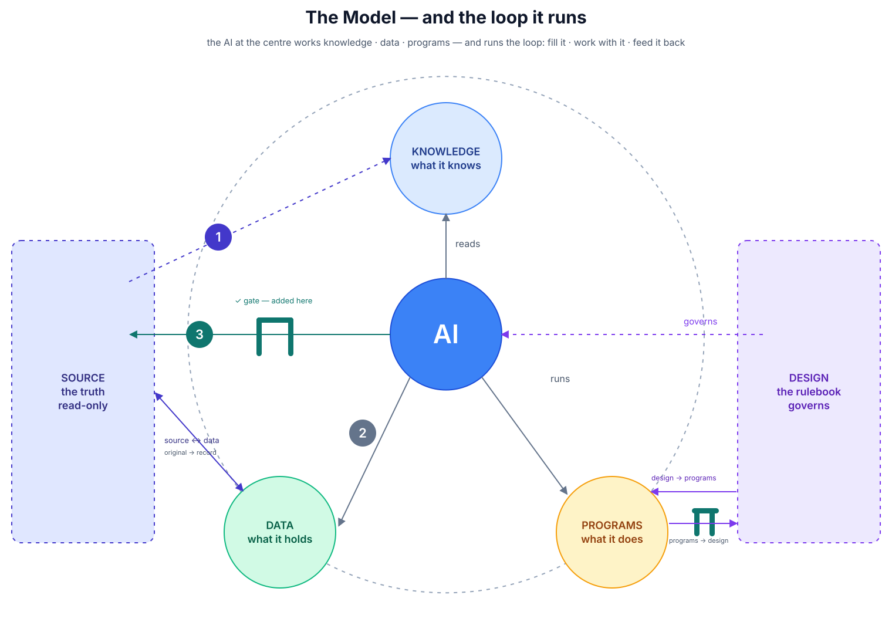

# Thermalwind

**Fractional COO and capital-project partner for food-tech scale-ups. And an open
blueprint for putting AI to work in a small business.**

## What is Thermalwind

Thermalwind helps food-tech and manufacturing scale-ups close the gap between today's
operations and tomorrow's production capacity. Fractional COO, capital-project delivery,
modular production systems, and operational readiness from scope definition through to
commissioning. The boring details decide whether a company survives, so that is where we
work.

## Why this repo exists

AI is moving fast, and we have to be ready for the shift. Not using it is not an option if
you want to stay competitive.

The tools most companies run on are under pressure. They are expensive, they are not
AI-ready, and many are old: Word, Excel, MS Project. Modern software can be driven two
ways: by hand, and through MCP (Model Context Protocol) by an LLM or an agent. SketchUp is
one example. There are many more.

## What I am doing

I am modernising how I run a business. Not in theory, in daily use:

- CRM and contact follow-up
- Technical report generation
- Draft 3D models and visualisation
- Project tools
- Budget
- Planning and action follow-up
- Procurement

and more as it comes.

## What I found

- The legacy tools must, and can, be replaced. Word and Excel give way to Obsidian and
  Grist. The surprise is you can do it without losing forward or backward compatibility.
- Most modern software can be managed by hand and through MCP by an agent.
- Things I was missing, or struggling with, turned out to be easy with modern AI tools.
- Domains I could not reach have opened up. Coding, small programs, simple scripts: done
  agentically. I describe how I want it to work, and most of the time it can be built.
- It gets extremely frustrating without the right structure and guard rails in place.
  Those rules are usually hidden inside a cloud product you do not control.

That last point is why this repo exists.

## What I am building toward

Next to helping start-ups and small organisations with operations and project management,
I want to help them implement AI effectively.

This repo is the structure to do it yourself. The source code, if you will.

## In this repo

- **[The blueprint](../blueprint.md)** — the design. A company's knowledge, data and programs
  live local-first, in files the company owns; an agent reads the knowledge, works the data
  and runs the programs; what it produces is a draft, which a person works over and feeds
  back in. The argument, the principles and the vocabulary live there, not here — so they
  have one home and cannot drift apart.
- **[Implement it](../implement.md)** — how to stand the system up in your own vault, written as
  it is walked.
- **[The template `_design`](../template/)** — the smallest version of the design that still
  works: the files a business fills in for itself.

## Status

Early. This is a first cut, not a finished product. The repository is sanitized: no
client, NDA or personal data is in here, ever. That is the one rule.

## License

TBD.

## Contact

🌐 [thermalwind.nl](https://thermalwind.nl)
